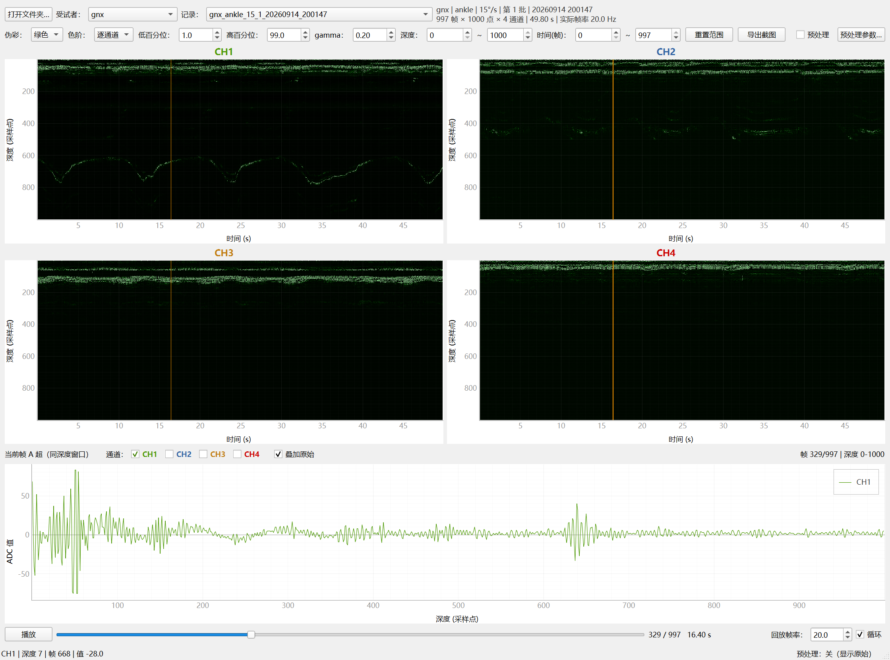
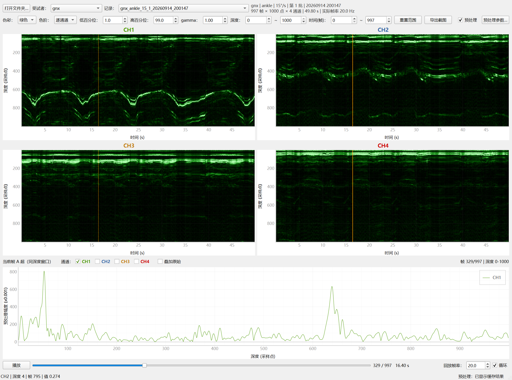

# Algorithm | 超声预处理算法介绍

使用超声采集设备扫描人体组织获得的原始波形数据，通常包含噪声、衰减和幅值差异等问题。
所以在进一步分析之前，需要对原始数据进行预处理。预处理的目的是增强信号的可读性和可比性，同时保留有用的特征信息。

处理顺序固定为：**带通滤波 → TGC → 希尔伯特包络 → 对数压缩（可选）→ 标准化 → 归一化 0–1（可选）**。每一步都可以在参数窗口里单独勾选开关，但相对顺序不变；全部关闭时输出等同原始数据。

| 步骤 | 参数 | 默认 | 说明 | 作用 |
|---|---|---|---|---|
| 带通滤波 | 低截止 MHz、高截止 MHz、阶数 | 3 / 7 / 4 阶 | 巴特沃斯零相位带通（`sosfiltfilt`），ADC 采样率 20 MHz，Nyquist 10 MHz；四通道共用一组参数 | 滤除直流偏置和高频噪声，只保留超声脉冲附近频率的信号 |
| TGC（时间增益补偿）| 增益强度（每 cm） | 0.4 /cm | `g(d) = exp(强度 × 深度cm)`；按 1540 m/s、20 MHz 换算，单点 ≈ 0.00385 cm（1000 点 ≈ 3.85 cm） | 超声回波信号会随着传播距离衰减，TGC 用于补偿深部信号的幅值，使得不同深度的回波在视觉上更均衡 |
| 希尔伯特包络 | 无 | 启用 | 取解析信号模长 | 将原始高频调制的信号转换为包络线，便于观察信号的幅值变化 |
| 对数压缩 | 压缩系数 k | 关，0.1 | `log10(1 + k × 包络)` | 将幅值范围压缩到较小的区间，增强低幅值信号的可见性，同时抑制高幅值信号的影响 |
| 标准化 | 无 | 开 | 逐帧对四通道整体 `(x-均值)/标准差`，保留通道间幅值差异 | 使不同通道的信号在统计上更加一致，便于比较和分析 |
| 归一化 0–1 | 无 | 关 | 逐帧把四通道整体缩放到 [0, 1] | 将信号幅值映射到固定范围，便于输入到机器学习模型或其他需要统一尺度的算法中 |

其中对数压缩、标准化和归一化是否启用取决于数据的分析需要。

## 截图示例

原始数据

预处理结果（启用带通滤波、TGC、希尔伯特包络、标准化、归一化）

## 参考文献

Yang, X., Sun, X., Zhou, D., Li, Y., & Liu, H. (2018). Towards Wearable A-Mode Ultrasound Sensing for Real-Time Finger Motion Recognition. IEEE Transactions on Neural Systems and Rehabilitation Engineering, 26(6), 1199～1208. https://doi.org/10.1109/TNSRE.2018.2829913
